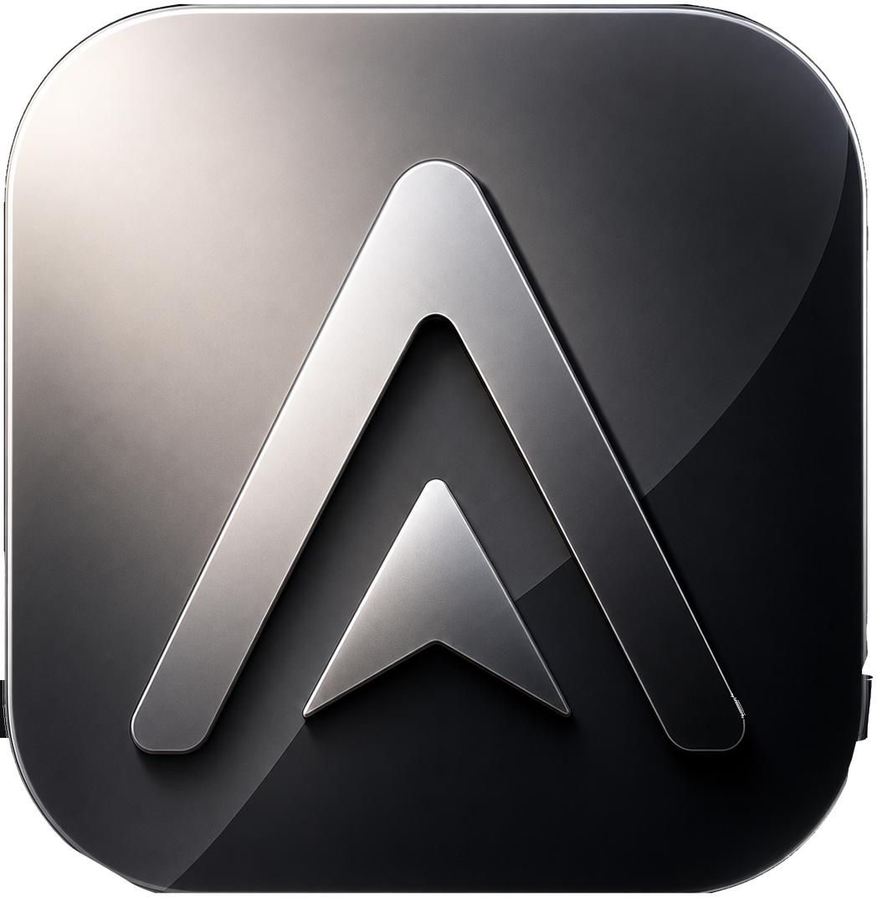
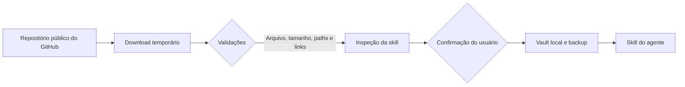

# Axis

<p align="center">
  
</p>

<p align="center">
  <strong>Central local para organizar agentes de IA, skills e projetos de desenvolvimento.</strong>
</p>

<p align="center">
  <a href="https://github.com/marquezinii/axis/actions"></a>
  
  
  
</p>

Axis reúne, em uma única aplicação local, a descoberta de agentes de programação com IA, o inventário de skills, a instalação segura de fontes públicas do GitHub e o acompanhamento de atualizações. O foco é simples: dar visibilidade e controle ao ambiente que já existe na sua máquina, sem exigir conta e sem enviar sua configuração para um serviço externo.

## O que você consegue fazer

- Detectar Codex, Claude Code, OpenCode e Antigravity a partir de configurações e caminhos conhecidos.
- Inventariar skills globais e de projetos, eliminando duplicatas entre agentes.
- Inspecionar `SKILL.md`, frontmatter YAML, arquivos e sinais heurísticos de risco antes de instalar.
- Instalar várias skills de um repositório público do GitHub para um ou mais agentes.
- Manter proveniência, commit de origem, hash SHA-256, cópia no Vault e backup local.
- Bloquear atualizações que poderiam sobrescrever modificações locais.
- Registrar fontes, projetos e atividades no próprio computador.
- Trabalhar inteiramente em Português (Brasil), com atalhos de teclado e paleta de comandos.

## Princípios do produto

| Princípio             | Como aparece no Axis                                                                                                      |
| --------------------- | ------------------------------------------------------------------------------------------------------------------------- |
| Local por padrão      | Banco SQLite, configurações, Vault e histórico permanecem em `LocalAppData`.                                              |
| Inspeção sem execução | Skills e binários detectados são lidos como conteúdo; o Axis não os executa durante descoberta ou instalação.             |
| Mudanças recuperáveis | Instalações gerenciadas têm hash, backup e troca com restauração em caso de falha.                                        |
| Limites explícitos    | Apenas repositórios públicos do GitHub são suportados nesta versão; credenciais privadas não são pedidas nem armazenadas. |

## Fluxo de segurança



O Axis aplica limites de arquivo e expansão de ZIP, rejeita caminhos inseguros e links simbólicos, não substitui diretórios não gerenciados e interrompe a operação se detectar alterações locais em uma skill gerenciada. A análise de risco é heurística: serve para orientar revisão humana, não para certificar conteúdo como seguro.

## Começar a usar

### Executável local

Após uma build local, abra o atalho **Axis** na Área de Trabalho. Ele aponta para o executável estável em `src-tauri/target/release/axis.exe` e é renovado sempre que `pnpm release:local` é executado.

### Desenvolvimento

Pré-requisitos: Windows 10/11, Node.js 22+, pnpm, Rust stable com MSVC, Visual Studio Build Tools e WebView2.

```powershell
git clone https://github.com/marquezinii/axis.git
cd axis
pnpm install
pnpm tauri dev
```

### Qualidade e distribuição

```powershell
# Formatação e frontend
pnpm format:check
pnpm check

# Backend Rust
cargo fmt --manifest-path src-tauri/Cargo.toml -- --check
cargo clippy --manifest-path src-tauri/Cargo.toml -- -D warnings
cargo test --manifest-path src-tauri/Cargo.toml

# Executável, instaladores e atalho da Área de Trabalho
pnpm release:local
```

Os instaladores NSIS e MSI ficam em `src-tauri/target/release/bundle/`. A build de desenvolvimento não é assinada; políticas de reputação do Windows podem exigir confirmação do usuário.

## Arquitetura

```text
React + TypeScript (interface)
        │ Tauri IPC com comandos específicos
        ▼
Rust (descoberta, staging, validação e instalação)
        │
        ├── SQLite: projetos, fontes, histórico e proveniência
        ├── Vault: cópia imutável por commit
        └── Backups: estado anterior à atualização
```

| Área                                | Responsabilidade                                                               |
| ----------------------------------- | ------------------------------------------------------------------------------ |
| `src/`                              | Interface React, experiência em Português (Brasil) e chamadas IPC restritas.   |
| `src-tauri/src/agents.rs`           | Convenções de descoberta e caminhos conhecidos de cada agente.                 |
| `src-tauri/src/skills.rs`           | GitHub público, staging, ZIP, inspeção, hash, Vault, instalação e atualização. |
| `src-tauri/src/storage.rs`          | Persistência SQLite no diretório local do sistema operacional.                 |
| `scripts/sync-desktop-shortcut.ps1` | Sincronização do atalho da Área de Trabalho após uma release local.            |

Leia [ARCHITECTURE.md](ARCHITECTURE.md) para os limites entre a interface, o backend e o sistema de arquivos.

## Privacidade e segurança

O Axis não é uma sandbox para skills depois que elas são instaladas no runtime de outro agente. Por isso, revise repositórios antes de instalá-los e trate resultados de baixo risco como um sinal, nunca como garantia.

O relatório completo de controles, limites e canais de reporte está em [SECURITY.md](SECURITY.md).

## Contribuição

Este repositório mantém CI para frontend e Rust, Dependabot semanal e templates para issues e pull requests. Consulte [CONTRIBUTING.md](CONTRIBUTING.md) antes de enviar alterações. Para regras de convivência, veja [CODE_OF_CONDUCT.md](CODE_OF_CONDUCT.md).

Não inclua segredos, dados pessoais, bancos SQLite locais, logs ou skills privadas em commits e issues.

## Estado do projeto

O estado operacional e decisões relevantes ficam em [PROJECT_STATE.md](PROJECT_STATE.md). O repositório é privado; a distribuição e a governança são mantidas pelo proprietário.
